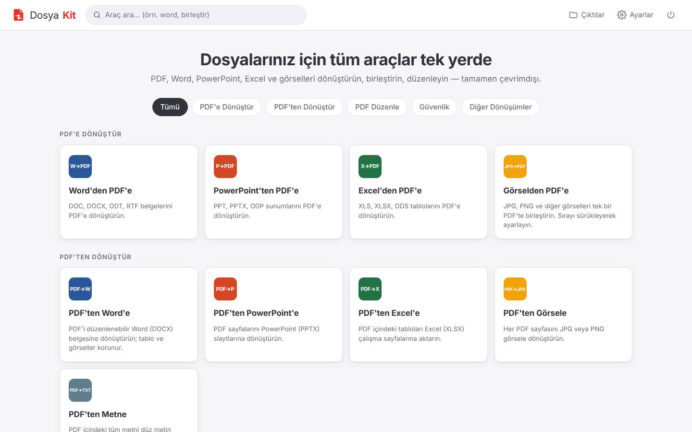

> **English:** DosyaKit is an iLovePDF-style file converter and PDF toolkit that runs **fully offline on your own PC**. Word / PowerPoint / Excel / images ↔ PDF, merge, split, compress, rotate, watermark, page numbers, AES-256 encryption and more — with a web UI served from `127.0.0.1` and Windows right-click integration. Files never leave your computer.
>
> Python · Flask · PyMuPDF · pdf2docx · python-docx / python-pptx / openpyxl · Pillow



---

# DosyaKit

iLovePDF tarzı, **tamamen bilgisayarınızda çalışan** dosya dönüştürme ve PDF düzenleme aracı.
Dosyalar internete gönderilmez. Arayüz tarayıcıda açılır ama sunucu sizin bilgisayarınızdır (127.0.0.1).

## Kurulum (Windows 10/11)

1. Bu klasörü kalıcı bir yere koyun (ör. `C:\DosyaKit`). Kurulum klasörü yerinde kullanır; sonradan taşımayın.
2. **`Kur.bat`** dosyasına çift tıklayın.
   - Python 3.9+ yoksa winget ile otomatik kurar.
   - Kütüphaneleri `.venv` içine kurar (sisteminizi kirletmez, yönetici izni istemez).
   - Masaüstü, Başlat menüsü ve **sağ tık > Gönder** kısayollarını ekler.
   - PDF/Word/Excel/PowerPoint/görsel dosyalarına **sağ tık > "DosyaKit ile işle"** ekler
     (Windows 11'de: sağ tık > *Diğer seçenekleri göster*).
3. Kurulum bitince DosyaKit kendiliğinden açılır.

Kaldırmak için `Kaldir.bat`.

### Word / PowerPoint / Excel → PDF için

Bu dönüşümler bir ofis programı ister:
- **Microsoft Office** kuruluysa onu kullanır (en iyi sonuç).
- Yoksa ücretsiz **LibreOffice** kurun: <https://www.libreoffice.org>

PDF → Word / PowerPoint / Excel / görsel ve tüm PDF düzenleme araçları ek program gerektirmez.

## Araçlar

| Kategori | Araçlar |
|---|---|
| PDF'e dönüştür | Word, PowerPoint, Excel, Görsel (JPG/PNG…) → PDF |
| PDF'ten dönüştür | PDF → Word (DOCX), PowerPoint (PPTX), Excel (XLSX), JPG/PNG, TXT |
| PDF düzenle | Sıkıştır, Birleştir, Böl, Sayfa çıkar, Sayfa sil, Sırala, Döndür, Filigran, Sayfa numarası |
| Güvenlik | Şifrele (AES-256), Şifre kaldır |
| Diğer | Ofis biçimleri arası (DOC↔DOCX, XLS↔XLSX, ODT, ODS, CSV…), Görsel biçimleri arası (PNG/JPG/WEBP/ICO) |

Kullanım ipuçları:
- Birden fazla dosya seçerseniz tek tek dönüştürülür; sonuçlar ZIP olarak inebilir.
- Birleştirme ve görselden PDF'te dosyaların sırasını sürükleyerek değiştirebilirsiniz.
- Sonuç ekranındaki **"Sonucu başka bir araçla işleyin"** ile işlemleri zincirleyebilirsiniz
  (ör. Word → PDF → Sıkıştır → Şifrele).
- Sonuçların kopyası `Belgeler\DosyaKit` klasörüne kaydedilir (Ayarlar'dan değiştirilebilir).
- Kapatmak için sağ üstteki ⏻ düğmesi.

## Geliştirme

```
DosyaKit/
├─ DosyaKit.pyw            başlatıcı
├─ app/
│  ├─ main.py              tek örnek kontrolü, sunucuyu başlatma, sağ tıkla gelen dosyalar
│  ├─ server.py            Flask API + arka plan işleri
│  ├─ registry.py          araç kayıt sistemi (@tool dekoratörü)
│  ├─ util.py              ortak yardımcılar (sayfa aralığı, Türkçe font, dosya adları)
│  ├─ config.py            klasörler ve ayarlar
│  ├─ engines/office.py    MS Office (COM) / LibreOffice dönüşüm motoru
│  ├─ tools/               ← ARAÇLAR BURADA (her .py otomatik yüklenir)
│  └─ web/                 arayüz (HTML/CSS/JS, bağımlılıksız)
└─ kurulum/                Windows kurulum betikleri
```

### Yeni araç eklemek

`app/tools/_ornek_arac.py` dosyasını kopyalayıp adını `_` ile başlamayacak şekilde değiştirin
(ör. `meta_duzenle.py`). Minimum örnek:

```python
from ..registry import tool, opt_text
from ..util import out_path, open_pdf

@tool(id="pdf_meta", title="PDF Bilgileri", description="Başlık/yazar değiştir.",
      category="organize", accepts=[".pdf"], badge="ℹ", color="#00897b",
      options=[opt_text("title", "Başlık")])
def run(files, outdir, opts, progress):
    doc = open_pdf(files[0])
    doc.set_metadata({**doc.metadata, "title": opts["title"]})
    dst = out_path(outdir, files[0].stem, ".pdf")
    doc.save(str(dst))
    return [dst]
```

- Arayüz kartı ve seçenek formu **otomatik** oluşur; HTML yazmanız gerekmez.
- Seçenek türleri: `opt_select`, `opt_number`, `opt_text`, `opt_password`, `opt_check`, `opt_color`.
- `mode="all"` → tüm dosyalar tek seferde gelir (birleştirme gibi); `mode="each"` → her dosya ayrı.
- `progress(0.5, "mesaj")` ile ilerleme çubuğunu güncelleyin.
- Kullanıcıya hata göstermek için `raise ToolError("...")`.
- Not göstermek için `return {"files": [...], "notes": ["..."]}`.
- Yeni kütüphane gerekiyorsa `requirements.txt`'ye ekleyip `Kur.bat`'ı tekrar çalıştırın.

Değişikliklerden sonra DosyaKit'i kapatıp yeniden açın. Hataları görmek için
**`DosyaKit (konsol).bat`** ile başlatın; kayıtlar `%LOCALAPPDATA%\DosyaKit\dosyakit.log` dosyasındadır.

### Geliştirme fikirleri

- OCR (Tesseract ile taranmış PDF'i aranabilir yapma)
- PDF sayfa küçük resimleri ve sürükle-bırak sayfa düzenleyici
- PDF → PDF/A, imzalama, form doldurma
- HTML/URL → PDF
- PyInstaller ile tek `.exe` paketleme

### Mimari notlar

- Sunucu sadece `127.0.0.1`'e bağlanır; her API çağrısı açılışta üretilen rastgele bir anahtar ister
  ve Host başlığı denetlenir. Böylece başka web siteleri yerel sunucuya erişemez.
- Aynı anda tek örnek çalışır; ikinci açılış (ör. sağ tık) dosyaları çalışan örneğe devreder.
  Explorer'da çoklu seçimde gelen dosyalar 2 saniye içinde tek oturumda toplanır.
- Microsoft Office COM işlemleri kilitle sıraya alınır (Office aynı anda birden çok
  otomasyon işinde kararsız olabiliyor).
